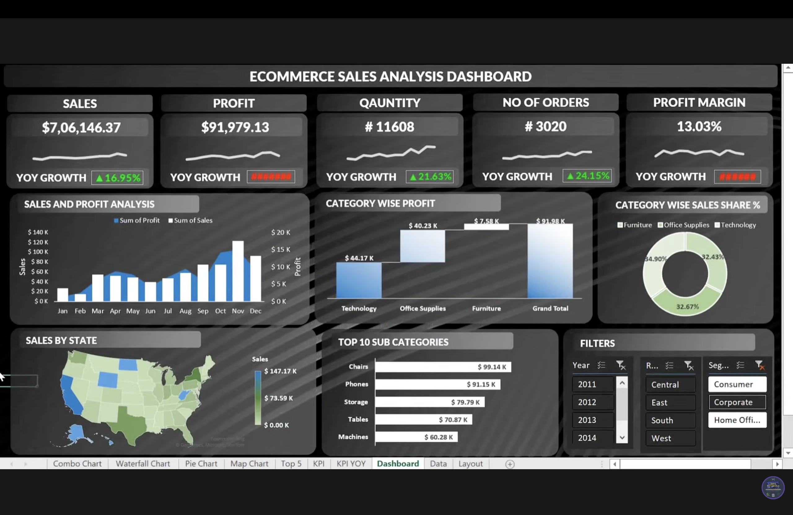

# ecommerce-sales-analysis-excel-dashboard
An executive-level e-commerce sales and profitability analysis dashboard built in Excel featuring dynamic KPI tracking, seasonality trends, category distribution, and geographic heatmaps.

# 🛒 E-Commerce Sales Analysis Dashboard & Business Case Study

## 📌 Project Overview
In the competitive e-commerce landscape, data-driven decision-making is critical to optimizing operational efficiency, maximizing profitability, and identifying high-growth product categories and geographic market. This project features a comprehensive business case study and an executive-level interactive Excel dashboard that consolidates multi-dimensional sales, profit, quantity, and order data.

---

## 📊 Dashboard Preview

---

## 🎯 Key Performance Indicators (KPIs & Metrics)
* **Total Sales:** $7,06,146.37 *(or dataset aggregate over multiple fiscal years)*
* **Total Profit:** $91,979.13
* **Total Quantity:** 11,608 units
* **Total Orders:** 3,020 orders
* **Overall Profit Margin:** 13.03%

---

## 🔍 Core Business Objectives & Analytical Framework
The dashboard provides deep visibility into key operational areas:
1. **Unified KPI Tracking:** Real-time monitoring of Sales, Profit, Quantity, Orders, and Profit Margins alongside Year-over-Year (YoY) growth indicators.
2. **Temporal & Trend Analysis:** Monthly sales and profit trajectories (Jan-Dec) to evaluate seasonal peaks and performance velocity.
3. **Category Portfolio Optimization:** Evaluates profit contributions and sales shares across major categories (*Technology, Office Supplies, and Furniture*) using waterfall and donut charts.
4. **Geographic Insights:** Interactive filled map showing state-by-state revenue distribution and regional performance across Central, East, South, and West markets.
5. **Sub-Category Rankings:** Ranks top-performing sub-categories (such as *Chairs, Phones, Storage, and Tables*) to optimize inventory investments.

---

## 💡 Key Analytical Problem Scenarios Addressed
* **Seasonal Revenue Divergence:** Identifying months with high revenue volume versus those experiencing margin compression or profit dips due to heavy discounting.
* **Category Profitability Paradox:** Analyzing why certain categories capture significant sales share yet generate disproportionate profit margins.
* **Regional Disparities:** Uncovering market penetration gaps between coastal and central states to propose targeted logistical adjustments.

---

## 🛠️ Tools & Technologies Used
* **Microsoft Excel:** Pivot Tables, Advanced Slicers, Formulas, Waterfall Charts, Donut Charts, and Filled Maps.
* **Data Visualization & Dashboard Design:** Executive dark-themed UI layout with interactive cross-filtering.
* **GitHub:** Version control and professional portfolio hosting.

---

## 📂 Repository Structure
* `Ecommerce Sales Analysis.xlsx` - Main Excel workbook containing raw data sheets, processing tables, and the interactive dashboard interface.
* `Ecommerce_Sales_Analysis_Problem_Statement.pdf` - Official problem statement, functional requirements, and analytical guidelines.
* `Dashboard Screenshot` - High-resolution visual preview of the dashboard layout.

---
